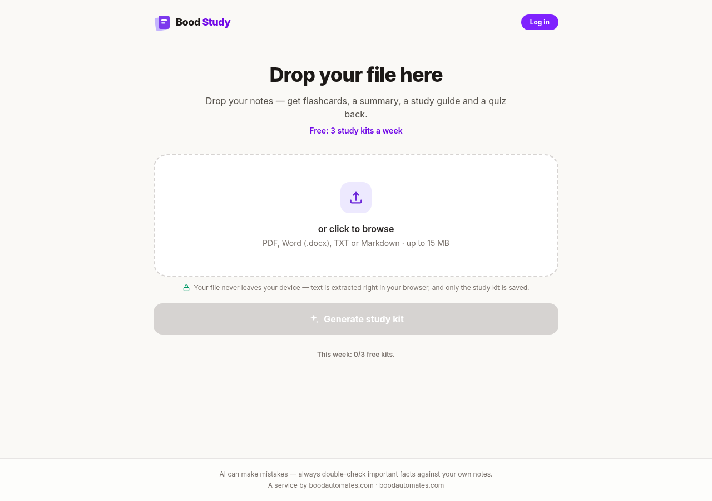

# Bood Study

**Drop your notes — get flashcards, a summary, a study guide and a quiz back.**

Free AI study-kit generator, live at [study.boodautomates.com](https://study.boodautomates.com).
Drop a PDF, Word doc, TXT or Markdown file and get a complete study kit in a few minutes.
Free: **3 study kits a week**, no card needed.



## Why it's built this way

- **Your file never leaves your device.** Text extraction runs entirely in the
  browser (`pdfjs-dist` worker for PDFs, `mammoth` for Word, `FileReader` for
  text) — only the extracted *text* is sent for AI processing. The file itself
  is never uploaded.
- **Chapter detection for big books** — pure TypeScript, zero server calls:
  PDF outlines/bookmarks, repeated ALL-CAPS running headers, and heading
  patterns ("Chapter 3", "12. Title", roman numerals) are detected client-side.
  Pick up to 3 chapters and get one merged kit (chapter-headed summary/guide,
  combined cards + quiz). Verified on a real 269-page ebook.
- **Async job runner.** Generation takes 2-5 minutes (GLM-5.3-Flash is a
  reasoning model), which no proxy will wait for — so `POST /api/generate`
  returns a `jobId` instantly, the AI call runs in-process, and the client
  polls. Chapter kits run their AI calls **in parallel** (a 3-chapter deck
  takes ~one call's duration, not 3×), with progress reported per chapter.
- **Abuse-resistant by design.** Freemium quota (3 kits/week per account or
  IP, counted on success only), a global daily cost fuse, a burst limiter,
  Cloudflare Turnstile on anonymous use, mandatory email verification with
  per-IP verification-email caps, and `noindex` on shared deck pages.

## Stack

Next.js 16 (App Router) · React 19 · Tailwind 4 · SQLite via `better-sqlite3`
· Together.ai (`GLM-5.3-Flash`) · Resend (transactional email) · Cloudflare
Turnstile (optional).

## Self-hosting

```bash
npm install
cp .env.example .env   # fill in TOGETHER_API_KEY, NEXT_PUBLIC_SITE_URL
npm run build && npm start
```

Environment variables (see `.env.example`):

| Variable | Purpose |
|----------|---------|
| `TOGETHER_API_KEY` / `TOGETHER_MODEL` | AI generation |
| `NEXT_PUBLIC_SITE_URL` | canonical URL (email links) |
| `RESEND_API_KEY` / `EMAIL_FROM` | verification + password-reset email |
| `DAILY_GLOBAL_LIMIT` | global daily generation fuse |
| `TURNSTILE_SECRET_KEY` / `NEXT_PUBLIC_TURNSTILE_SITE_KEY` | optional captcha |

## Project layout

```
app/api/generate/    job-based generation endpoints (text + multipart fallback)
app/api/auth/        register / login / verify / forgot / reset
lib/job-runner.ts    async AI job execution (parallel chapter calls)
lib/chapters.ts      client-side chapter detection (pure TS)
lib/auth.ts          scrypt password hashing + sessions
lib/email.ts         branded transactional email templates
components/          dropzone, chapter picker, deck viewer
```

## License

MIT — see [LICENSE](LICENSE).
